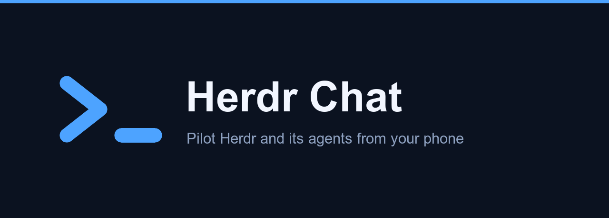

**Pilot Herdr and its agents from your phone.** Herdr Chat is a PWA that reads your
Pi, codex, opencode, devin and Claude Code sessions and lets you drive them from
anywhere in your tailnet.

No SSH. No terminal on the phone. Nothing is copied out of your machine.

## What it does

- **Conversations, not terminals.** Each agent's session is rendered as it actually
  reads: messages, thinking, tool calls, diffs, subagent results. Long output stays
  folded.
- **Answers you when you are not looking.** Push notifications tell you when an agent
  finishes — and says *"needs you"* when it is waiting on a question, instead of
  claiming it is done.
- **Questions, with their choices.** When an agent blocks on a prompt, Herdr Chat
  reads it off the screen and shows the real options as buttons.
- **Send, answer, stop, change model.** All through Herdr's own API, with the same
  confirmations — nothing is reported as sent until the transport says so.
- **Honest by default.** A missing value is shown as missing. An error carries its
  cause. Nothing is invented to fill a gap.

## Requirements

- **Herdr** running on the same machine (`~/.config/herdr/herdr.sock`).
- **[Tailscale](https://tailscale.com)** for remote access. The server binds to
  `127.0.0.1` only — Tailscale Serve is the single supported way in.

## Install

```bash
brew trust xDelph/herdr-chat     # newer Homebrew asks before loading third-party taps
brew install xDelph/herdr-chat
brew services start herdr-chat
```

> The formula published today (`v0.1.x`) still installs the former TypeScript
> daemon. The native formula (`packaging/herdr-chat.rb`, single `herdrchat`
> binary, same port and variables) is prepared but **not published**; it replaces
> the old one only through the reviewed switch-over in `docs/BASCULE.md`.

Then expose it to your tailnet:

```bash
tailscale serve --bg http://127.0.0.1:8791
```

Open `https://<your-machine>.<tailnet>.ts.net` on your phone and add it to the
home screen. It installs as a normal app: its own icon, no Safari chrome.

If port 443 is already taken, serve on an explicit port — the address then
carries it:

```bash
tailscale serve --bg --https=8790 http://127.0.0.1:8791
```

Either way, Herdr Chat reads `tailscale serve status` at startup and allows the
matching origin, so there is nothing to declare by hand. (Port 443 is **omitted**
from that origin — browsers never send `:443` — which is why the default setup
works without extra configuration.)

## How it fits together

```text
iPhone ── Tailscale ── Serve :443 ── 127.0.0.1:8791 ── Herdr Chat
                                       (ou :8790, au choix)
                                                            │
                                                            ├── Herdr socket     (control)
                                                            └── session stores   (content)
```

**Herdr stays the orchestrator.** Herdr Chat is a local layer: it reads, displays and
forwards. It never replaces Herdr and never starts a second agent behind your back.

Content and catch-up come from the **session files**, never from the API — Herdr's
`revision` is always `0` and only one event type is implemented. Control and status
come from the **socket**. See `docs/PROTOCOL.md` for what was measured, and
`docs/DECISIONS.md` for why.

## Configuration

Every variable is optional — a bare install works.

| Variable | Default | Purpose |
|---|---|---|
| `HERDR_REMOTE_BIND` | `127.0.0.1` | Interface to bind. Never expose publicly. |
| `HERDR_REMOTE_PORT` | `8791` | Local port |
| `HERDR_REMOTE_PUBLIC_ORIGINS` | derived | Extra allowed origins, comma-separated |
| `HERDR_REMOTE_LOG_PATH` | `~/.herdr-remote/herdr-remote.log` | Error journal |
| `HERDR_REMOTE_PUSH_STORE` | `~/.herdr-remote/push.json` | Push subscriptions |
| `PI_SESSIONS_ROOT` | `~/.pi/agent/sessions` | Pi session root |
| `CODEX_SESSION_ROOT` | `~/.codex/sessions` | codex session root |
| `CLAUDE_PROJECTS_ROOT` | `~/.claude/projects` | Claude Code session root |
| `OPENCODE_DB` | `~/.local/share/opencode/opencode.db` | opencode session database |
| `DEVIN_DB` | `~/.local/share/devin/cli/sessions.db` | devin session database |

Each agent type is only offered once its session store has actually been read and
measured. Types whose store could not be read are refused rather than guessed —
see `type_lisible` in `crates/application/src/visibilite.rs` for the current list.

The VAPID key pair for push notifications is generated on first run and stored
alongside the subscriptions. `HERDR_REMOTE_VAPID_SUBJECT`,
`HERDR_REMOTE_VAPID_PUBLIC_KEY` and `HERDR_REMOTE_VAPID_PRIVATE_KEY` override it;
`HERDR_SOCKET_PATH` (or `HERDR_SOCKET`) points at a non-default Herdr socket and
`HERDR_REMOTE_FILES_ROOTS` adds readable file roots.

## Running from a checkout

The daemon is a single native binary, `herdrchat` (Rust, `crates/herdrchat`),
with the PWA embedded at build time. Bun is only needed to **build** the PWA; it
is never needed to run the daemon.

```bash
bun install --frozen-lockfile
bun run build                                 # apps/web/dist, embedded by the next step
cargo build --release --locked -p herdrchat   # target/release/herdrchat
bin/herdrchat                                 # or: bun run start
```

`bin/herdrchat` execs `target/release/herdrchat` (else `target/debug/herdrchat`,
or `HERDRCHAT_BIN` when set) and fails with the build commands when none exists.
Release archives (`.github/workflows/release-rust.yml`) contain the binary itself:
macOS arm64/x86_64 and Linux x86_64/aarch64, each with a `.sha256`.

The switch-over procedure from the former TS service, and its rollback, are in
`docs/BASCULE.md`.

## Development

```bash
nvm use          # reads .nvmrc
bun install
bun run verify   # web + shared: format → lint → typecheck → tests
cargo run --locked -p xtask -- verify   # Rust: layout, coverage, graph, fmt, clippy, tests
bun run dev      # Vite dev server
```

Both gates must be green before any commit. The test suite is the design
contract: each test carries a requirement id, and changing a rule is expected to
break a test. `docs/FINAL-GATE.md` lists the complete pre-release gate.

The former TypeScript daemon (`apps/server`, Bun + Effect) was removed at T068;
`docs/BASCULE.md` explains how to run it from git history if a comparison is
ever needed.

## License

[PolyForm Noncommercial 1.0.0](LICENSE). Free for personal and noncommercial use.
Commercial use requires a separate license.
