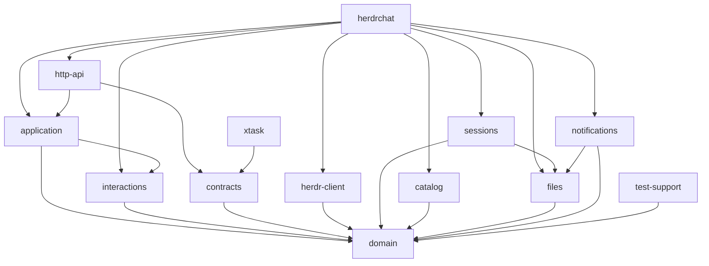
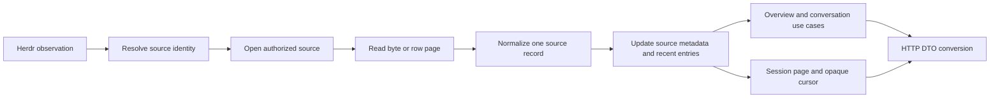

# Rust backend architecture

Status: **implementation plan for assignment, not started**. Updated 2026-10-18. Target language is Rust. [TASKS.md](TASKS.md) fixes execution order and completion criteria; [ADAPTERS.md](ADAPTERS.md) fixes common foundations and agent composition. No Rust code or dependency installation is part of this change. The user will choose who implements it.

## 1. Context and scope

Replace the Bun/Effect backend with one native Rust daemon while retaining every capability in [CURRENT.md](CURRENT.md), all 18 API routes, the existing webapp, Herdr as the control authority, and read-only agent session stores as the content authority. The inventory baseline is commit `576bbf4902a00d3ef9702b4df315c943c7ac5680`. The execution base is `d19f98d23b02cacf7d6d9d97facf8d6360b0546b`; [BASELINE-DELTA.md](BASELINE-DELTA.md) adds the Codex title-discovery correction that must also be preserved at T023.

Key source references:

- [Route table and action orchestration](https://github.com/xDelph/herdr-chat/blob/576bbf4902a00d3ef9702b4df315c943c7ac5680/apps/server/src/http/Api.ts) — HTTP contract, launch, questions/trust, focus, stop, subscriptions.
- [Shared wire schemas](https://github.com/xDelph/herdr-chat/blob/576bbf4902a00d3ef9702b4df315c943c7ac5680/packages/shared/src/api.ts) — current public contract authority.
- [Session HTTP behavior](https://github.com/xDelph/herdr-chat/blob/576bbf4902a00d3ef9702b4df315c943c7ac5680/apps/server/src/http/routes-sessions.ts) — cursor semantics, resets, absence, SQLite branching.
- [Session resolution](https://github.com/xDelph/herdr-chat/blob/576bbf4902a00d3ef9702b4df315c943c7ac5680/apps/server/src/agents/SessionLocator.ts) — five source families plus Codex title/index fallback.
- [Watcher](https://github.com/xDelph/herdr-chat/blob/576bbf4902a00d3ef9702b4df315c943c7ac5680/apps/server/src/events/AgentWatcher.ts), [prompt delivery](https://github.com/xDelph/herdr-chat/blob/576bbf4902a00d3ef9702b4df315c943c7ac5680/apps/server/src/send/PromptSender.ts), [push store](https://github.com/xDelph/herdr-chat/blob/576bbf4902a00d3ef9702b4df315c943c7ac5680/apps/server/src/notifications/PushNotifications.ts).

The complete module ownership map and 171 current contract/constant declarations plus 11 inline schemas are adjacent documents. Compatibility means preserving supported behavior and data, while explicitly recording defects that should not become Rust invariants. No speedup is asserted before comparable measurements exist.

## 2. Workspace and crate boundaries

Use 13 workspace members: eleven production crates, one development-only test-support crate and `xtask`. Names have no project prefix. Rust edition 2024, toolchain and MSRV 1.94.1 (installed version inspected 2026-10-18). One shared Cargo.lock, centralized dependency versions/features and lint policy; internal packages publish=false. Crates are architectural boundaries inside one process, not independently deployed services. No tests reside under any src directory, including existing TypeScript tests after T004.

```text
Cargo.toml                         # virtual workspace
Cargo.lock
rust-toolchain.toml
crates/
  domain/src/
    ids.rs status.rs observation.rs session.rs catalog.rs errors.rs ports.rs naming.rs notifications.rs
  contracts/src/
    http/ events.rs registry.rs presence.rs limits.rs schema.rs
  herdr-client/src/
    transport.rs wire.rs client.rs capabilities.rs
  sessions/src/
    resolver.rs index.rs pipeline.rs registry.rs cursor.rs metadata.rs path_policy.rs
    storage/jsonl/{reader,framing,history,identity}.rs
    storage/sqlite/{worker,paging,row}.rs
    families/openai/{arguments,text,chat,responses}.rs
    families/anthropic/messages.rs
    codecs/{pi,opencode}.rs
    agents/{pi,codex,claude,opencode,devin}/
  catalog/src/
    cache.rs process.rs args.rs adapters/{pi,claude,codex,cursor,devin}.rs
  interactions/src/
    engine.rs recognize.rs plan.rs verify.rs error.rs registry.rs
    families/{numbered,selection,free_text}.rs
    agents/{pi,codex,claude,opencode,devin}.rs
  files/src/
    confined.rs atomic.rs policy.rs authorized_file.rs scan.rs mime.rs
  notifications/src/
    store.rs vapid.rs delivery.rs payload.rs
  application/src/
    state.rs refresh.rs overview.rs conversations.rs sessions.rs
    commands/{prompt,stop,focus,launch,question,trust}.rs
    events/{journal,subscription,watcher}.rs
    git.rs diagnostics.rs
  http-api/src/
    router.rs extractors.rs errors.rs origin.rs assets.rs
    handlers/{health,overview,conversations,sessions,commands,catalog,files,push,events,log}.rs
  herdrchat/src/
    main.rs config.rs composition.rs shutdown.rs logging.rs assets.rs
  test-support/src/
    fake_herdr.rs fake_clock.rs temp_stores.rs fixtures.rs push_sink.rs
xtask/src/
  contracts.rs inventory.rs verify_layout.rs release.rs
crates/<crate>/tests/
  unit_tests.rs                    # mod unit; → unit/mod.rs
  unit/{mod,cases}.rs
  integration_tests.rs             # mod integration;
  integration/{mod,cases}.rs
  contract_tests.rs                # mod contracts;
  contracts/{mod,cases}.rs
  property_tests.rs                # mod properties;
  properties/{mod,cases}.rs
tests/fixtures/                    # synthetic JSONL, SQLite builders, screens, wire corpus
apps/server/tests/                 # TS baseline comparisons; no tests under src
apps/web/tests/
packages/shared/tests/
packages/shared/src/generated/     # generated frontend types/validators, when migration begins
```

| Member | Owns | Must not own |
|---|---|---|
| `domain` | IDs, statuses, observations, normalized entry/metadata/catalog models, domain error taxonomy, narrow I/O port traits, pure naming/ranking and interaction values | HTTP, Tokio tasks, sockets, filesystem access, environment reads |
| `contracts` | Public request/response/event DTOs, exact serde representation, endpoint registry, shared limits, schemas and contract version | Source discovery, business orchestration, side effects |
| `herdr-client` | Unix transport, request correlation, upstream response decoding, explicit measured capabilities, implementation of control port | HTTP, content reads, decision policy, agent-session writes |
| `sessions` | Source resolution, JSONL/SQLite readers and normalizers, source-bound cursors, session index/metadata cache, read-only source policy | Herdr commands, API statuses, UI state |
| `catalog` | Fixed catalog commands, parser adapters, single-flight/TTL cache, launch args/level validation | Agent launch, terminal keys, arbitrary command strings |
| `interactions` | Shared recognize/plan/execute/verify engine, numbered/selection/free-text families and explicit agent profiles | HTTP, global pane queues, source-file reads, unmeasured fallback keys |
| `files` | Authorized handles, MIME/download policy, bounded recent-image scan | Workspace lookup, arbitrary root configuration, agent commands |
| `notifications` | Legacy-compatible push JSON, VAPID lifecycle, payload naming, delivery/expired subscriptions | Decide which agent transitions should notify, mutate agent state |
| `application` | Shared state, refresh ownership, use cases, summaries, watchers, event journal, action serialization, branch reader | Route extraction, frontend state, raw external wire decoding |
| `http-api` | All routes, extractors, origin/body policy, DTO conversion, status mapping, SSE serialization, static responses | Direct agent commands, raw source DB access, persistent state ownership |
| `herdrchat` | Config/env, dependency wiring, runtime/task lifecycle, logging, embedded assets, signal handling | Business rules duplicated from libraries |
| `test-support` | Temp stores, fake ports and clocks, recorded synthetic payloads, operation capture | Production defaults or access to user agent sockets |
| `xtask` | Contract export/check, inventory coverage, release assembly | Runtime service logic |

Do not create one crate per source parser initially: the five adapters share identity, cursor, metadata, and file/SQLite machinery. Their modules and fixture boundaries permit a later split if compile dependencies justify it. Do not create a generic utilities crate; place helpers with the subsystem whose invariant they enforce.

### Dependency direction

Arrows mean “depends on.” The binary composes I/O adapters behind ports; the application uses the shared interactions engine and does not import concrete I/O adapters. `domain` may use serde/schemars for shared value enums; it remains pure with respect to I/O. HTTP wire structs live only in `contracts`.



`http-api` explicitly depends on domain types as needed for exhaustive mapping. Adapter raw wire/storage structs are private and do not become frontend DTOs. Cross-cutting logging uses `tracing` in each crate rather than importing daemon logging code. Test-support can be a dev-dependency without inducing production dependency cycles; keep it independent of the binary/HTTP crates.

## 3. Contracts and frontend interoperability

### One authority

Until T057, `packages/shared/src/api.ts` remains authoritative for the active app. Rust wire DTOs are developed against its frozen corpus and explicit corrected expectations, not enabled as a second production authority. At T057, `contracts` Rust DTOs become authoritative and the TS facade becomes generated. Shared domain enums are referenced rather than redefined. A typed endpoint registry holds method/path, named operation, request/query/body type, success/failure status variants, content type and mutation policy. Both router registration and OpenAPI export consume that registry; do not maintain an independent route/status table by hand.

Use serde plus Schemars to emit JSON Schema. `xtask contracts export` produces versioned JSON Schema and OpenAPI 3.1 documents, TypeScript types and standalone runtime validators from those documents. Proposed frontend generator tooling: [json-schema-to-typescript](https://github.com/bcherny/json-schema-to-typescript) and [Ajv standalone](https://ajv.js.org/standalone.html) (2020-12 mode). These are build-time tools; the Rust daemon does not need Node/Bun. Generated validator modules are included in the existing web bundle.

During transition, `packages/shared/src/api.ts` becomes a compatibility facade over generated exports after all callers/tests have been adapted in one reviewed change. Avoid keeping hand-written Effect validators beside hand-written Rust DTOs as two permanent sources. Pure frontend helpers can remain TypeScript; generated runtime validation must continue at every backend response boundary where it exists today. SSE, push payloads, inline log/subscription bodies and non-JSON results gain named contracts too.

Schemars supports serde-aware schema generation; custom presence types below need explicit schema implementations and round-trip checks. Generation alone is not proof that validators and serde accept exactly the same objects. [Schemars documentation](https://docs.rs/schemars/latest/schemars/).

### Field presence and values

| Current shape | Rust wire representation | Required behavior |
|---|---|---|
| Required `T` | `T` | Missing/null rejected unless T itself admits null |
| Required `T\|null` | `Nullable<T>` wrapper | Key always emitted; missing is error; null is valid |
| Optional `T` | `Field<T>` with Missing/Present | Missing omitted; explicit null rejected for nonnullable T |
| Optional `T\|null` | `Field<Nullable<T>>` | Missing, null and value are three different states |
| Unknown JSON | `serde_json::Value` / retained raw JSON | Preserve flexible content; do not overfit external adapters |
| Closed literal union | Enum with explicit serde renames | Exact existing English/French wire strings |
| Object extra fields | Normal serde ignore-on-input policy | Match existing Struct stripping unless specifically approved otherwise |

Do not represent all four rows with plain `Option<T>`: it normally conflates absence and null on decode. `Field` has an explicit missing default and custom deserialization when a field is present; `Nullable` admits null but cannot make an absent required field pass. Schema generation and positive/negative fixtures must cover both. Internal domain models can use ordinary Option where the distinction no longer matters.

JSON numeric compatibility is explicit: public Schema.Number fields presently lack many integer/range checks. Separate raw numeric decoding from typed internal byte offsets/counts. Preserve normal values and reject impossible filesystem positions at the use boundary with the documented API error; add integer/range restrictions to schema only through a reviewed contract change. File metadata must not silently lose precision when crossing JS's safe-integer range.

Use dedicated types `PaneId`, `TabId`, `WorkspaceId`, `SessionId`, `SourceKey`, `RequestId` and `DeliveryFingerprint` internally. Do not change their string serialization or existing camelCase HTTP / snake_case Herdr spelling. Do not expose Rust error variant names automatically on the network.

### Response mapping

Every H01–H18 route has an explicit response enum in `contracts`, including non-2xx shapes, empty 204, binary files, plain text VAPID key and SSE. HTTP conversion in `http-api` exhaustively maps domain results into these variants. JSON serializers use only typed response variants; schema validation in contract tests verifies that these serializers match generated frontend validators. An unexpected result must be a named/logged 500, never a fabricated empty success.

An architecture correction ledger in §10 defines which current defects deliberately change. Existing absence/refusal/uncertainty unions and legitimate unusual statuses remain supported. Do not silently “clean up” all responses into one generic error envelope and break existing clients.

### Proposed Rust wire names

The following names replace the current schema symbols; the exact fields remain those in CONTRACTS.md except approved ledger changes. Domain observations are separate models, converted exhaustively to these DTOs at the HTTP boundary.

| Current public definition | Proposed Rust type in `contracts` |
|---|---|
| HealthResponse | `http::health::HealthResponse` |
| AgentViewSchema / WorkspaceViewSchema / OverviewResponse | `http::overview::{AgentView, WorkspaceView, OverviewResponse}` |
| SessionEntrySchema / SessionResponse | `http::sessions::{SessionEntry, SessionResponse}` |
| SessionCursor + encode/decodeCursor | Legacy/versioned private codec in `sessions`; HTTP continues opaque String |
| PromptSentResponse / PromptSuppressedResponse / PromptFailedResponse | `http::commands::{PromptSentResponse, PromptSuppressedResponse, PromptFailedResponse}` |
| StopAgentResponse / AgentFocusedResponse | `http::commands::{StopAgentResponse, AgentFocusedResponse}` |
| LaunchAgentRequest / LaunchAgentResponse | `http::launch::{LaunchAgentRequest, LaunchAgentResponse}` |
| InstalledKind / InstalledKindsResponse | `http::catalog::{InstalledKind, InstalledKindsResponse}` |
| AgentModel / ModelCatalogResponse | `http::catalog::{AgentModel, ModelCatalogResponse}` |
| RecentImageSchema / RecentImagesResponse | `http::files::{RecentImage, RecentImagesResponse}` |
| TrustRequiredResponse / TrustResolvedResponse | `http::interactive::{TrustRequiredResponse, TrustResolvedResponse}` |
| QuestionAnsweredResponse / Choix / Question | `http::interactive::{QuestionAnsweredResponse, Choice, Question}` with original serialized field names |
| ConversationSummary / ConversationsResponse | `http::conversations::{ConversationSummary, ConversationsResponse}` |
| ApiErrorResponse / SessionState | `http::errors::ApiErrorResponse` / shared domain `SessionState` |
| PromptBody / AnswerBody / TrustBody | `http::commands::PromptRequest`, `http::interactive::{AnswerRequest, TrustRequest}` |
| Inline log body / {ok} | `http::diagnostics::{ClientLogRequest, ClientLogResponse}` |
| Inline subscribe/unsubscribe | `http::push::{SubscribeRequest, UnsubscribeRequest}` plus request union preserving unsubscribe precedence |
| Plain VAPID key / empty subscription result / file body | Typed non-JSON endpoint variants, not fictitious JSON DTOs |
| Untyped SSE data payloads | `events::{Ready, AgentStatusChanged, PromptDelivered, PromptSuppressed, AgentLaunched, Resync}` |
| AgentInfo / workspace/tab/layout/snapshot / protocol reply | Private `herdr_client::wire` structs mapped to domain observations; do not reuse HTTP DTOs as upstream decoders |
| Pi entry types / LignePi / ChangePi | `domain::session` values plus private source structs in `sessions::adapters` |
| PushStore / PushPayload | Private legacy persistence schema in `notifications` / shared `domain::notifications::PushPayload` re-exported and schema-exported by contracts |

Primitive shared enums such as AgentStatus and SessionState live in `domain` with serde/schema derives and are re-exported by contracts. Preserve `Choice`'s `numero`, `libelle`, `selectionne`, `detail` and Question's `choix`, `contexte`, `invite`, `texte` through serde renames. Renaming Rust identifiers does not change the wire.

### Port and application interface sketches

These signatures describe the proposed Rust boundary; they are design sketches, not checked-in or compiled implementation. All request types carry owned target/source identity, so a queued operation cannot borrow mutable current-selection state. Narrow port errors preserve upstream kind and partial-action evidence. The application facade exposes domain values; HTTP DTO conversion remains outside it.

```rust
// domain::ports; no Tokio or HTTP dependency
type PortFuture<'a, T> = Pin<Box<dyn Future<Output = Result<T, PortError>> + Send + 'a>>;

trait ControlPort: Send + Sync {
    fn ping(&self) -> PortFuture<'_, HerdrVersion>;
    fn snapshot(&self) -> PortFuture<'_, Snapshot>;
    fn integrations(&self) -> PortFuture<'_, Vec<Integration>>;
    fn get_agent(&self, target: PaneId) -> PortFuture<'_, AgentObservation>;
    fn list_agents(&self) -> PortFuture<'_, AgentListObservation>;
    fn read_screen(&self, request: ScreenRead) -> PortFuture<'_, ScreenObservation>;
    fn prompt(&self, command: TargetedPrompt) -> PortFuture<'_, PromptEvidence>;
    fn send_text(&self, command: TargetedText) -> PortFuture<'_, TransportEvidence>;
    fn send_keys(&self, command: TargetedKeys) -> PortFuture<'_, TransportEvidence>;
    fn focus(&self, target: PaneId) -> PortFuture<'_, FocusEvidence>;
    fn create_tab(&self, command: CreateTab) -> PortFuture<'_, CreatedTab>;
    fn start_agent(&self, command: StartAgent) -> PortFuture<'_, StartEvidence>;
    fn close_tab(&self, owned: OwnedLaunchTab) -> PortFuture<'_, TransportEvidence>;
}

trait SessionPort: Send + Sync {
    fn resolve(&self, hint: SessionHint) -> PortFuture<'_, ResolvedSource>;
    fn metadata(&self, source: SourceIdentity) -> PortFuture<'_, SessionMetadata>;
    fn page(&self, read: SessionRead) -> PortFuture<'_, SessionPage>;
}

trait CatalogPort: Send + Sync {
    fn catalog(&self, kind: AgentKind) -> PortFuture<'_, CatalogObservation>;
    fn launch_args(&self, choice: LaunchChoice) -> PortFuture<'_, ValidatedArgs>;
}

trait ArtifactPort: Send + Sync {
    fn open(&self, request: AuthorizedFileRequest) -> PortFuture<'_, ArtifactBody>;
    fn recent_images(&self, roots: AuthorizedRoots) -> PortFuture<'_, ImageScan>;
}

trait NotificationPort: Send + Sync {
    fn public_key(&self) -> PortFuture<'_, VapidPublicKey>;
    fn subscribe(&self, subscription: BrowserSubscription) -> PortFuture<'_, ()>;
    fn unsubscribe(&self, endpoint: PushEndpoint) -> PortFuture<'_, ()>;
    fn notify(&self, event: AgentAttentionEvent) -> PortFuture<'_, ()>;
}
```

`NotificationPort::notify` reports admission/delivery failure, not a guarantee that the phone displayed a banner. Clock, branch lookup and diagnostic sink are additional narrow injected ports; tests replace them with fakes. Root policies are constructed by startup/application authorization and cannot be bypassed by an arbitrary HTTP path string. `OwnedLaunchTab` is issued only for a tab created by this operation.

| Application method | Routes | Domain result |
|---|---|---|
| `health()` | H01 | Backend/Herdr reachability observation |
| `overview()` / `conversations()` | H02/H03 | Snapshot-derived views / isolated session summaries |
| `session(SessionReadRequest)` | H04 | SessionPage with cursor/reset/absence evidence |
| `submit_prompt(TargetedPrompt)` | H05 | Confirmed / Unknown / Suppressed / Failed |
| `interrupt(PaneId)` / `focus(PaneId)` | H06/H11 | Interrupt/no-op / focus outcome |
| `launch(WorkspaceId, LaunchChoice)` | H07 | Started / TrustRequired / phase-qualified failure |
| `installed_kinds()` / `catalog(AgentKind)` | H08/H09 | Verified integration policy / catalog observation |
| `answer(TargetedAnswer)` / `trust(TargetedTrustDecision)` | H10/H12 | Applied/transmitted/refused domain outcomes |
| `record_client_error(ClientDiagnostic)` | H13 | Diagnostic acceptance |
| `subscribe_events(ResumeToken)` | H14 | Owned journal replay + live subscription |
| `push_key()` / `update_subscription(SubscriptionChange)` | H15/H16 | Public key / persisted subscription change |
| `open_artifact(PathRequest)` / `recent_images()` | H17/H18 | Authorized body / image scan |

## 4. Runtime ownership and reads

### Shared observations

`Application` holds narrow ports and cloneable handles to actors/services; it does not expose a global lock over all work. Proposed core services:

- `SnapshotService`: one in-flight Herdr snapshot refresh; stores complete immutable snapshot plus observation time/generation and upstream version/protocol. Poll every two seconds while preserving upstream capability limits; refresh requests coalesce. Cache empty snapshots as valid observations. Ordinary view reads reuse a successful snapshot at most two seconds old, otherwise join a refresh; refresh failure maps to the existing endpoint error instead of presenting stale data as fresh. Health uses a separately coalesced ping observation with a one-second TTL. Control admission and file-root authorization force a refresh, sharing only an already in-flight request.
- `SessionResolver`: one cache of source references keyed by kind/reference/cwd/title and store generation. Positive entries revalidated on file identity changes; negative entries use a short TTL so a new session appears. Async/bounded archive index replaces recursive glob per request. Codex state files are sorted by parsed numeric version, not lexically; fallback still requires exact name+cwd and actual file existence.
- `SessionIndex`: one source read/index per source identity and cursor region, shared by list/chat clients. Cache contains source fingerprint, complete-byte offset or DB position, metadata, bounded recent entries and last observation. A forward/initial session HTTP read with `observe=1` renews a 30-second observation lease; `observe=0` and backward history reads do not. The optional query defaults to 1 for legacy clients and rejects values other than 0/1 with 400. Leased sources reconcile every 400 ms when working, 1200 ms otherwise. New clients send observe=1 only for a visible chat, 0 for a hidden recovery read. Without a lease, history is read only on demand. Never tail every historical file continuously.
- `ConversationService`: assembles summaries from one snapshot generation, source metadata and cached branch result; four session-read permits remain the initial default. Independent row failure becomes a row cause; aggregate snapshot failure remains explicit. It owns derived title/visibility policy once for both list and overview.
- `EventService`: journal and subscriber ownership described in §7. Status polling is independent of client count; content freshness is driven by source readers, never inferred from Herdr revision.

Changes are committed by source/snapshot generation. A slower refresh cannot replace a newer observation. A removed/rebound pane invalidates associated source resolution; same pane ID alone is not enough to reuse an old source identity. Cached data can serve a valid observation within its freshness policy, but stale authorization roots do not grant new file access.

Use short locks for map/bookkeeping swaps only. Do not hold locks across socket I/O, filesystem access, subprocess waits, database work or push delivery. Immutable observations can be shared with Arc; a small watch channel distributes the latest state. RwLock/Mutex and channel selection must follow ownership needs, not a desire to use an actor for every map.

### JSONL and adapter pipeline



Read raw bytes with explicit offsets. Keep an incomplete UTF-8/JSONL suffix as bytes until newline; decode complete records once. Define offset as the first byte not yet represented by a complete record. Either reread its suffix from that position or prepend buffered bytes when starting after them; never do both. Maintain source generation across descriptor identity checks and detect truncation/replacement before committing entries. A partial record is not invalid JSON until its complete line exists.

The normalizer returns one of `NormalizedMessage`, `NormalizedSettings`, `RetainedUnknown`, or `FilteredContext`. The compositional pipeline and module boundaries are fixed by ADAPTERS.md: storage engines, explicit OpenAI Chat/Responses family codecs and agent-specific envelopes/policies are separate. Codex and Devin share value primitives where proven, not an assumed identical storage/message format. Keep source raw JSON separate internally from normalized Pi-compatible JSON. The public `SessionEntry.raw` remains compatible with today's frontend adapters and block parser; this rewrite is not an opportunity to change it to a new canonical chat format. Retain explicit filtering of injected context and Claude's raw fallback protection.

Separate source-level message IDs from public normalized IDs. Preserve current stable IDs where supplied. Internal entries without an upstream ID may be addressed by source identity and byte span, but do not start exposing invented IDs as upstream truth. ParentId remains conversation ancestry; no new parent/subagent relation is guessed.

Initial and history windows remain 512 KiB for JSONL, 400 rows for SQLite, 64 KiB for summary tails. Metadata reduction retains current latest-model/provider pairing, no placeholder models, optional timestamp, last prompt, assistant/tool preview and explicit read cause. Screen enrichment preserves numbered-question/trust precedence and the optional last-12-lines `waiting` fallback for blocked agents with an unrecognized screen. Preserve the bounded 32-window metadata search initially; an application-owned index may improve coverage later without editing source stores.

### SQLite workers

Use [rusqlite](https://docs.rs/rusqlite/latest/rusqlite/struct.Connection.html) in bounded, dedicated database workers with read-only connections and bound parameters. Each worker owns its connection and accepts jobs over a bounded channel; no connection is shared through an async mutex while executing SQL. Keep the three-second busy timeout, query-only policy and adapter-specific schema errors. Do not set journal mode or modify agent DB pragmas with persistent effects.

Long-lived workers use dedicated threads; short isolated blocking jobs can use semaphore-limited `spawn_blocking`. Started blocking tasks cannot simply be aborted, so job timeouts must use SQLite interruption/progress facilities and bounded work, not just dropped futures. This distinction follows Tokio's documented behavior. [Tokio spawn_blocking documentation](https://docs.rs/tokio/latest/tokio/task/fn.spawn_blocking.html).

opencode's mutable newest row must be reread with inclusive seq boundary; Devin preserves row_id behavior. Poll active source tails and periodically reconcile a bounded recent mutable window. Do not claim that a higher sequence detects arbitrary edits to older rows. Catalog/read adapters report unsupported DB schema explicitly; no guessed alternate queries or read/write opening fallback.

### Cursor generations and boundedness

New cursors remain opaque base64 JSON. Propose internal versioned body `{v:1,sourceKind,sourceKey,generation,position}` bound to the actual session/store. `sourceKey` is an opaque digest, not a secret or authentication capability. Generation captures file identity/truncation epoch or DB-session/store generation. Continue accepting legacy `{dev,ino,offset}` file cursors during transition, with identity validation. Legacy SQLite cursors are ambiguous: refresh/reset to the current source rather than trust a cursor from another session; stale backward requests return 409. Unsupported versions fail 400, not offset zero.

T025 implements the explicit C18 extension: optional `caughtUp:boolean` on forward/initial responses. False means another request with the returned cursor is needed; true means all complete records at the request's source watermark were returned. An incomplete trailing record stays pending and is not exposed as complete. Keep `hasMore` for older history, removing the current SQLite forward overload. Source readers process bounded chunks; target serialized page size is 2 MiB including the envelope, absolute maximum 16 MiB. A single large record can exceed the target only if the complete response fits the maximum. Otherwise return 422 with a named oversized-record cause in the error text, without advancing past it. No source record is skipped silently. Cursor advances only through returned complete entries; no change to the ReadCause enum is needed. T057/T059 implement immediate sequential catch-up, one request in flight, at most four pages before yielding to the UI; continue until caughtUp without claiming freshness early. Legacy clients can ignore the additive field and continue polling their opaque cursor.

Filesystem notifications may later wake JSONL readers, but use them as hints and retain stat/reconciliation polling. Watching a SQLite main file alone is insufficient when changes live in WAL. Initial Rust parity does not depend on a filesystem watcher crate.

## 5. Commands and uncertainty

All commands capture a typed target identity at admission. A command must never pick its destination from whichever conversation is currently displayed when it completes/retries. `application` owns per-pane admission and the shared `interactions` engine composes recognize/plan/execute/verify with agent profiles. Serialize multi-step interactive operations per pane so number/Enter/text/Enter cannot interleave with stop, trust or a second prompt. Queues are bounded and return explicit overload instead of silently dropping commands.

`ControlPort` exposes only measured operations: ping, snapshot, get/list agent, read screen, prompt, literal text, keys, focus, create/close owned launch tab, start agent and integration list. Generic protocol request is private to the adapter; do not expose arbitrary upstream methods in HTTP. Source ports only read. Catalog process ports execute fixed command argv.

### Prompt flow

1. Validate route/body/origin/UTF-8 size; resolve target and current observed agent identity.
2. Acquire per-pane command admission; inspect the dedup record under the same command ownership.
3. Read current agent status. Preserve blocked literal-input path and the narrowly recognized “blocked and requires interactive input” refusal fallback. Never fall back on a timeout, general protocol failure or guessed state.
4. Send via the selected Herdr method. Verify method-specific expected success payload before labeling confirmed. Unknown/partial response becomes an uncertainty value.
5. Record confirmation evidence, publish the matching event, return a typed result. A successful text write followed by failed Enter is a partial action and must retain uncertain state; it is not proof that nothing happened.

Keep the current fingerprint algorithm during compatibility. Proposed dedup policy corrects known discrepancies: last confirmed text per pane, 60 s monotonic window; A→B→A can send; unknown/failed attempts do not establish confirmed suppression. A per-pane queue prevents simultaneous duplicate check/send races. This is not crash-proof exactly-once delivery: Herdr has no idempotency key. Never automatically retry a mutation with an ambiguous upstream result. The ledger calls out these behavior corrections for review.

### Stop and focus

Stop still requires a fresh working-agent observation and sends Ctrl+C through Herdr. Nonworking returns not-running, absent returns 404, transmitted interrupt is not confirmed termination. No PID signals or process discovery are added.

Focus retains the existing endpoint and real desktop effect. The Rust backend must not silently replace it with invented acknowledgement. Whether the webapp automatically invokes it is a separate frontend product decision, outside backend parity. Keep failure as focused:false where currently required.

### Launch state machine

`Validate → CreateTab → AwaitShellAndStart → Started | TrustRequired | Failed`.

Validate installed/readable integration, workspace, checkout, requested name, args and reasoning levels **before** creating a tab. Normalize command/target consistently for listing and launch. Reserve generated names locally for concurrent requests; upstream name conflict is still authoritative. Never loop back to a taken name after suffix exhaustion.

Create an unfocused tab with known cwd and label. Record ownership of the newly created tab/pane. Retry start only after the explicit available-shell refusal, preserving the three-second/ten-retry baseline. Other failures and transport ambiguity stop retries. Set start RPC deadline to 125 seconds for the upstream 120-second detection timeout. A launch operation has an overall 160-second deadline covering up to 30 seconds of explicit shell-readiness retry spacing and one detection attempt; no retry is allowed after an ambiguous start. The current transport's blanket 15 s deadline must not survive unchanged.

If blocked, read screen and return trust-required only for a known prompt. Never answer it automatically. Clean up only the tab created by this operation, only when known not to contain a started/uncertain agent. Do not close a user-owned tab or erase an agent whose start result timed out. Client disconnect during start does not establish failed launch; keep the operation tracked through completion or deadline and log resulting resource identity.

Return existing v1 launch response/status shapes. Keep internal phase/created pane/cause structured for diagnostics. Exposing those as new error fields is an additive contract proposal, not an implicit migration change. No durable command journal is required for initial parity; after daemon restart, command outcome can remain unknown and must not be replayed automatically.

### Questions and trust

Retain question parsing and family key sequences in the common engine plus explicit profiles defined by ADAPTERS.md. Under the pane command lock, reread visible screen immediately before choosing a number/sequence and verify the offered choice and prompt fingerprint. Selection movement is computed from the actually recognized highlighted option; never blindly reuse Claude Down/Enter when selection is already elsewhere. Reject unrecognized prompt/family without sending keys. Trust always requires explicit accept/refuse supplied by the caller.

Read after action. For trust, also validate a decoded still-present agent and identity, not just a successful agent.get RPC. Preserve transmitted/applied/refused distinctions. A disappeared prompt alone does not prove a particular decision was accepted, especially if replaced by a different prompt or the agent exited. Return ambiguous results as transmise until evidence is sufficient. For free text, validate the same request body budget and preserve ordered selection/Enter/text/Enter behavior.

## 6. Files, configuration and diagnostics

### Authorized filesystem capabilities

`files` receives authorized project roots from a sufficiently fresh workspace observation plus configured extra roots. Root lookup failure cannot become an unrestricted path read. Maintain current dynamic revocation behavior: file authorization requests refresh/coalesce a snapshot rather than authorize indefinitely from stale cache.

Represent successful access as an `AuthorizedFile` owning the opened descriptor and metadata. Put the common engine in `files::confined`, using [cap-std directory capabilities](https://docs.rs/cap-std/latest/cap_std/fs/struct.Dir.html) with relative opens, plus Unix nonblocking/no-device checks on the opened object. `sessions` reuses this engine with its own source-root policy; it does not duplicate path resolution. Revalidate metadata, require regular files and enforce size. Canonicalize alone is not a complete race defense. macOS and Linux path-race/FIFO fixtures are mandatory; Linux-specific openat2 is not the sole implementation. Application-owned atomic JSON writes live in `files::atomic` and are reused by notifications, with a distinct writable store-root type that cannot be constructed from a read-only source capability.

Serve current MIME/download behavior, content length and no-store. Derive response length from bytes actually served and handle concurrent truncation explicitly. Close descriptors through RAII on every path. Reject directory/FIFO/device access without blocking on open. Scan with the same confinement policy, no outward symlink traversal, explicit global permit/budget ownership, depth/exclusion limits and last-modified ordering. Keep partial unreadable-root behavior, but report diagnostic completeness internally.

### Configuration

`herdrchat::config` loads all 17 explicit environment keys in CURRENT §8 exactly once into an immutable typed config and passes it to adapters. Also support existing plural/singular precedence, independent CODEX_HOME/session root and push/log locations, extra roots, VAPID pair and automatic Serve origin discovery. No library reads environment directly. HOME/PATH resolve through injected startup context for deterministic tests.

Parse bind as IpAddr and allow loopback/default plus actual Tailscale ranges, rather than string prefixes. The proposed tightening to 100.64.0.0/10 and fd7a:115c:a1e0::/48 is recorded as a reviewed correction; keep default 127.0.0.1 and no wildcard/public bind. Parse ports strictly, normalize origins structurally, preserve HTTPS default-port removal and explicit nondefault ports. Accept loopback origin compatibility initially; narrowing it to exact served origins requires a separate policy decision.

Read Tailscale Serve status through fixed argv with five-second limit and the current known-location/PATH search. Absence remains optional degradation. No process is terminated merely because it holds a port; a bind collision reports the actual bind error and exits.

### Errors and observability

Domain errors include InvalidInput, NoSource, SourceAbsent, SourceInvalid, SourceIo, PathDenied, UpstreamUnavailable, UpstreamRejected, UpstreamMalformed, Deadline, PartialAction, Overloaded and InternalInvariant. Each contains safe user detail plus structured diagnostic context; it does not carry an HTTP status. `http-api` maps variants per endpoint's response registry.

Use tracing spans with operation ID, source identity, durations, bytes and command phase. Avoid prompt bodies, raw sessions, VAPID private keys and subscription auth material in routine logs. Preserve a compatibility text sink at the existing journal path, client log ingestion, 4 MiB/one-generation rotation and repeated-message suppression. Logging sink errors surface to stderr with a bounded warning but do not fail user commands. Suppression must count repeated messages if it advertises such counts; current implementation does not emit the promised count.

Add internal counters/histograms for snapshot requests/coalescing/age, source discovery/read/cache hits/bytes, DB wait time, command queue/partial outcomes, SSE active/lag/disconnects and push delivery outcomes. No new public metrics endpoint is required for parity; export format/access is a later operational decision. Health keeps the existing DTO and optional fields, not an undocumented substitute liveness response.

## 7. Event replay, subscriptions and notifications

### Journal and SSE

`EventService` owns a bounded VecDeque journal and broadcast/wakeup channels. Commit ID assignment, retained event and subscriber notification under one short ownership step. Subscription creation atomically obtains a replay boundary and live receiver so events cannot fall between replay and subscription. A broadcast receiver is a wakeup hint; replay authority is the journal, which detects gaps and sends resync.

Retain existing five journal event kinds plus ready/resync control events and their data shapes. Default retention is 500 events, eight connections; also propose a 4 MiB journal byte cap and 256 KiB maximum event so cardinality does not pretend to bound arbitrary payload size. Byte eviction breaks continuity explicitly with resync. Use an owned stream permit whose drop closes subscription and releases count once. No per-client polling loop.

Propose opaque SSE event IDs `<boot-uuid>:<sequence>` while keeping existing payload numeric cursor/resumeFrom fields. EventSource treats IDs as opaque; current webapp does not parse IDs. Unknown boot epoch and legacy numeric IDs cause one resync at subscription, then resume from a current boundary. Missing ID starts at current boundary after ready; it does not replay the entire historical journal into a new window. A future/unavailable sequence also resyncs. Corrected behavior is documented in §10.

Send SSE comment heartbeats every 15 s; slow consumers that exceed retention receive resync or an explicit reconnect rather than accumulate unbounded queues. Use Axum Sse/KeepAlive; connection drops cancel tasks automatically through owned handles. Keep the existing over-capacity 503, media type and no-cache semantics. [Axum SSE documentation](https://docs.rs/axum/latest/axum/response/sse/).

T053 adds the named `session_changed` invalidation event with `{paneId,sourceRevision:string}` from actual source observations. No prompt text/path is included. Repeated observations of the same revision are coalesced; a source shared by panes invalidates each current binding. T057/T059 replace 400 ms frontend polling with these events plus a ten-second visible recovery read, a sixty-second hidden recovery read and immediate foreground/resync read. Recovery reads renew the backend's observation lease only while a chat is visible. Existing status events and push triggers remain separate. This requires coordinated frontend support; it never uses unsupported Herdr pane-output events.

### Notification service and store

Application watcher alone decides E06 transition rules; notifications crate formats/sends them. Retain last identity for disappeared agents and distinct waiting/done/gone tags/deep links. Observer failure is not a mass disappearance event. Initial snapshot does not notify that every agent appeared or finished. Gracefully missing status is unknown, not done.

Use the Rust `web-push` library behind a delivery port; its VAPID builder can accept raw URL-safe base64 private keys used by Node libraries. Validate imported public/private key equivalence against fixtures before any cutover, preserve existing P-256 keypair/subscription keys, TTL 60 s and 404/410 pruning. The library choice does not by itself prove subscription compatibility. [VAPID raw-key support](https://docs.rs/web-push/latest/web_push/struct.VapidSignatureBuilder.html).

One store writer serializes subscription/key changes. Persist the legacy PushStore JSON representation through temp-file + flush + atomic rename, creating directory 0700 and file 0600. Preserve old populated-store precedence and whole-store legacy migration. A malformed store fails visibly and never regenerates keys silently. Do not hold the store writer across network delivery: snapshot recipients/key generation, deliver with bounded concurrency, then remove only endpoints still matching the expired subscription version.

Fixed initial limits: one bounded 64-notification queue, four concurrent deliveries, per-delivery deadline 15 s. Queue exhaustion is logged/counted with agent identity; watcher/control paths continue. Coalesce pending repeats by pane/status without collapsing a needs-answer notification into generic finished. Initial parity has no durable push outbox and no claim of exactly-once notifications.

## 8. Task lifetime, budgets and release

Run a multi-thread Tokio runtime. Root cancellation owns snapshot poller, source reconciliation, event subscriptions, notification delivery and background log worker. Track spawned tasks; no fire-and-forget loop can outlive its service. Cancellation stops admission and read work. Commands past a side-effect boundary retain outcome tracking and never become automatic retries.

Shutdown order: stop accepting new requests/commands; signal readers/poller/subscriptions; finish or classify in-flight commands within a defined grace deadline; flush store/log writer; close DB workers/descriptors; stop HTTP. Proposed initial grace deadline is ten seconds for ordinary work, with unresolved control operations recorded as unknown. Blocking DB work has real interruption/busy limits because dropping a Tokio future cannot stop started blocking code. No shutdown action closes or kills user agents.

| Budget | Proposed initial setting / treatment |
|---|---|
| JSON request body | 64 KiB actual streamed bytes, not only Content-Length |
| Prompt | 32 KiB UTF-8 |
| Initial/history JSONL | 512 KiB source window |
| Summary | 64 KiB tail, 32-window cold metadata budget, 256 cached sources |
| Source read concurrency | 4 globally initially, not 4 multiplied by each HTTP request |
| SQLite workers | Bounded one worker per configured source DB initially; bounded 32-job queue per worker |
| Herdr socket frame | Proposed 16 MiB; reject explicit malformed/oversize, never silently truncate |
| Herdr query deadline | 15 s baseline; start RPC 125 s / overall launch 160 s; no blanket mutation retries |
| Per-pane command queue | Proposed 8 pending operations; reject new excess explicitly |
| Catalog | 20 s, 2 MiB stdout, 64 KiB stderr, 60 s success cache; one shared task per kind |
| Git branch | 3 s, 30 s cache; output capped while reading; one in-flight job per cwd |
| Artifact | 12 MiB; same root/MIME rules |
| Images | depth 3, true global 400 matching files, 120 per directory, 60 returned, four roots concurrently |
| SSE | 8 active, 500 retained events + 4 MiB, 15 s heartbeats |
| Push | 64 queued, 4 deliveries, 15 s deadline, TTL 60 s |
| Logging | 4 MiB/one prior generation; bounded detail and repeat state |

These are fixed initial plan values, not claims of measured workload requirements. T065 checks them under the frozen workloads; an inadequate value fails acceptance and requires an explicit documented plan revision, not a silent per-agent override. Oversized failures must be explicit and route-mapped. Session cache budgets are 256 source entries and 64 MiB of retained raw/normalized data globally, evicting least-recently-used unleased entries first; leased entries over budget stop retaining old payloads while preserving cursor/metadata. Report byte use. A 512 KiB source window also does not mean the serialized normalized response has the same byte size.

Build the PWA once with its existing toolchain, then embed that dist directory into the Rust binary, preserving MIME/no-cache/fallback behavior and version matching. The resulting runtime requires neither Bun nor Node. Keep an explicit build-time failure if assets are absent; fixture/test builds can inject a tiny synthetic asset provider. Resolve configuration/data paths from user home or explicit env, never process cwd except the legacy push-import location.

Release target proposal: macOS arm64/x86_64 and Linux x86_64/aarch64, native CI builds or validated cross compilation as needed; bundled SQLite and Rustls avoid an undocumented system OpenSSL/SQLite dependency. Preserve `herdrchat` executable name, formula service name/port and PolyForm Noncommercial license. The tap update is later explicit deployment work; no tap/service is changed by this spec. Keep archived old release artifacts and unchanged PushStore format so rollback remains possible.

## 9. Coverage: every current capability has an owner

| Current IDs | Primary Rust owner | Mapping / invariant |
|---|---|---|
| O01–O04 | herdrchat + application | Startup, health warning, supervised watcher, signal shutdown |
| O05–O07 | herdrchat + http-api | Embedded assets, confinement, SPA/no-build/cache behavior |
| O08–O10 | herdrchat + xtask | Native launcher/release, service packaging, verification gates |
| H01 | http-api health → application SnapshotService | Health wire variants retained |
| H02–H03 | http-api overview/conversations → application | One observation/visibility policy, isolated row errors |
| H04 | http-api sessions → application → sessions | All file/DB pagination/reset/absence modes |
| H05–H07 | http-api commands → application | Prompt, stop, explicit launch and uncertainty |
| H08–H09 | http-api catalog → application / catalog | Integration discovery distinct from catalog/readability |
| H10–H12 | http-api commands → application | Fresh-screen answer, focus, explicit trust decision |
| H13 | http-api log → injected diagnostic port | Client error ingestion and log sink |
| H14 | http-api SSE → application EventService | Replay, resync, limits, cancellation |
| H15–H16 | http-api push → notifications port | Plain key, subscribe/unsubscribe, persistent keys |
| H17–H18 | http-api files → application authorization → files | Dynamic roots, body/MIME and images |
| D01–D05 | application + domain | Snapshot/enrichment/workspaces/naming/visibility |
| D06–D17 | sessions + domain | All five readers, Codex fallback, headers, normalizers, DB paging |
| D18–D20, D22 | application + sessions metadata reducer | Summary/caching/error isolation/conservative values |
| D21 | application git module | Branch metadata cached by actual cwd |
| A01–A12 | application commands + interactions families/profiles + herdr-client | Shared action state machine and source-of-truth checks |
| A13–A15 | catalog | Five catalogs, fixed argv, args/levels/cache |
| E01–E06 | application | Poll/diff/replay/notification trigger |
| E07–E10 | notifications + herdrchat startup | Payload/keys/delivery/legacy import |
| S01–S03 | herdrchat + http-api | Network bind, origin, methods, actual body limit |
| S04 | sessions | Source confinement and read-only descriptors |
| S05–S09 | application + files | Authorized roots/handles/MIME/scan |
| S10–S13 | http-api + herdrchat logging + typed domain errors | Truthful responses, validation, diagnostics |
| S14 | test-support + all ports | No user-agent tests or unrequested agent input |

Every file-level assignment is in SOURCE-MAP.md; its finer ownership (for example summary metadata versus presentation) follows the table above. `SessionReader` fixtures become test support, not a production reader. Declared upstream methods that are not invoked remain documented capability metadata, not new public routes.

## 10. Compatibility and correction ledger

These are explicit planned corrections included by the user's 2026-10-18 request. They are not silently folded into an “identical” migration promise. TASKS.md fixes each implementation and proof; no correction is implemented by this documentation change.

| Item | Existing behavior | Proposed Rust behavior | Client / rollout impact |
|---|---|---|---|
| C01 | Shared `api.ts` authority | Rust DTO/registry authority, generated TS types + runtime validators | Coordinated frontend imports/decoders; no hand-written duplicate schema |
| C02 | Partial JSONL bytes double-counted in summary cache | Single byte-position convention | Fix derived corruption; source untouched |
| C03 | Trust service state discarded, response fails contract | Return complete TrustResolvedResponse | Restore declared behavior; no approval auto-granted |
| C04 | Some incremental read errors replaced with empty success; SQLite exceptions may escape handler | Preserve typed failure/cause/status | Errors become visible instead of false emptiness |
| C05 | Normal prompt success record considered confirmed without discriminator check | Validate expected success evidence | Some formerly confirmed responses become unknown/failure |
| C06 | Dedup any recent identical text; unknown key path recorded; concurrent race | Per-pane last-confirmed dedup plus serialized admission | Correct A→B→A/retry behavior; preserve fingerprint/window |
| C07 | Launch creates tab before args validation; 15 s socket vs 120 s detection | Validate first; reserve names; method deadline; cleanup only owned known-empty resources | Fewer orphan tabs, no duplicate launch on timeout |
| C08 | Read routes accept unintended methods; unknown API path returns HTML | GET/HEAD read policy, POST commands, 405 Allow, unknown /api JSON404 | Correct intended HTTP interface; list as deliberate behavior change |
| C09 | Content-Length-only request guard | Enforce actual 64 KiB during streamed read | Chunked/false-length oversized requests rejected |
| C10 | Prefix-only tailnet bind; parseInt permissive ports | Parsed actual tailnet ranges and strict decimal port | Invalid/ambiguous configurations now fail explicitly |
| C11 | Idle canceled SSE loop persists; no heartbeat; journal restart ambiguity | Owned subscription cancellation, heartbeats, epoch IDs/resync | EventSource-compatible opaque IDs; test old/new clients |
| C12 | SQLite cursors can refer to another source | Source-bound versioned cursor; legacy reset/409 rules | Existing client treats cursor opaque and handles reset; verify history reload UX |
| C13 | File/scan path races/outside-root metadata | Confined descriptor access and bounded scan | Refuse unsafe links; retain valid in-root symlink behavior where safe |
| C14 | Push store rewritten directly; network sends hold serialized access | Atomic compatible store; independent bounded delivery | Existing keys/subscriptions must work without resubscribe |
| C15 | Codex DB versions lexical order; fallback evidence incomplete in comments | Numeric version order; exact name/cwd/file checks; source generation | Correct index selection, fixture expected behavior explicit |
| C16 | List/launch integration filters disagree | One measured launchable/readable integration policy | Uninstalled state not offered; available policy derived from actual known semantics |
| C17 | Question/trust disappearance can be overinterpreted | Retain uncertainty until relevant agent/prompt evidence sufficient | May return transmise more often; never invent application proof |
| C18 | Forward reads allocate the entire appended remainder, hasMore overloaded for SQLite forward | Add optional caughtUp, bounded serialized pages, source watermark and explicit oversized-record failure | Cursor only advances through returned entries; frontend drains before fresh status |
| C19 | Pending/failed message UI state can cross panes and retry to current pane | Per-pane+session state and immutable action destination | Retry A while viewing B can only target A |
| C20 | Late async session response can overwrite another pane or a newer refresh | Abort/generation guards and source identity ownership | Old result ignored, new conversation can load independently |
| C21 | Worker controllerchange reload loses memory drafts/action state | Deferred worker activation/reload at safe boundary, explicit update action | No plaintext prompt persistence added; unresolved state prevents reload |
| C22 | Markdown tables empty, nested lists flattened, blocked says working, idle implies finished | Shape-correct renderer and exhaustive truthful status labels | Rendered content tests; no unsafe HTML; no invented completion time |
| C23 | Duplicate refreshes and all-or-nothing Promise.all | Shared in-flight client reads, result generation, independent endpoint failures | One refresh for concurrent signals; good data survives partial outage |
| C24 | Reading/status change automatically changes real desktop focus | Explicit UI action only; backend focus endpoint preserved | Opening/read-only navigation makes no focus mutation |
| C25 | aria-modal sheet leaves background interactive | Background inertness plus keyboard/pointer/focus restoration | Actual mounted/browser behavior, not only source-text assertions |
| C26 | Chat polls every 400 ms per client | Shared leased source observations, session_changed invalidation, visible/hidden recovery | Add observe query and typed event; no unsupported upstream event assumed |
| C27 | Typing recalculates whole history metadata/items | Isolated composer and stable history-derived values/scroll anchor | 2,000-message fixture detects work on each keystroke |

Not bundled into this migration: visual redesign/search, local unread tracking, new model-change endpoint, app login/multi-user authorization, adding unsupported session families, HTTP/3/WebSockets, persistent conversation DB, durable action replay, new metrics endpoint, source-store migrations or source read/write access. Removing automatic focus calls and the concrete frontend correctness issues above are now included corrections, not an implicit visual redesign.

Forward-response budgeting/content invalidations are explicit planned work at T025/T053/T057/T059 and corrections C18/C26, not existing functionality. Frontend safety/accessibility/performance corrections are T058–T063. A visual redesign, search feature or unread counter is not implicitly added to this execution plan.

## 11. Testing and validation plan

This section specifies future implementation acceptance; no tests are added or run for this documentation-only proposal. Use fake ports and synthetic stores by default. No live user-agent input, no writes to real session/config stores, no environment lifecycle commands and no port-holder killing. A real control-path check, if later explicitly needed, uses a disposable agent/pane created for that test under the project rules.

All Rust and TypeScript tests live outside src. T004 moves the historical TS tests first; Rust uses external Cargo test targets under each crate's tests directory, with unit/integration/contract/property modules declared by dedicated root files. No inline test modules, test attributes, include of tests from src or source-file reinclusion for private access. `xtask verify-layout` enforces this for tracked and new files and has a negative fixture proving rejection. Test-support's reusable builders are ordinary library code, not tests under src. All their assertions also reside under tests.

| Requirement | Proof required before parity signoff |
|---|---|
| All H01–H18 / DTOs | Table-driven request/status/media/header/body cases against router registry; exact route count; current-valid/current-invalid corpus decoded by both Rust and generated JS validators |
| Presence / enum / numeric semantics | Every optional/null/missing combination, French literals, extra-field handling, safe filesystem positions, unknown JSON preserved |
| D01–D10 | Synthetic snapshots with empty/missing optional fields; all naming/visibility branches; exact source resolution including Codex version/title/cwd/ambiguous index |
| D11–D17 | Positive/negative normalization corpus per source, unknown line preservation/context exclusion, stable public IDs, mutable SQLite row replay |
| Cursor correctness / C02,C12 | Partial byte and UTF-8 splits, newline boundary, oversized records, empty pages, rotation/truncation/rebind, stale/wrong-source/legacy/versioned cursors; property tests ensure no duplicate/lost complete records |
| D18–D22 | Isolated bad session does not clear others, last-known metadata and provider pairing, scan budget/caches, one branch subprocess per cwd |
| A01–A05 / C05,C06 | Captured operation sequence, exact target fixed through retry, concurrent same-pane admission, confirmed/unknown/partial/timeout/no-op, no action on denied inputs |
| A06–A08 / C07,C16 | Invalid options create no tab; owned-tab cleanup only; busy-shell retry only; timeout does not duplicate launch; installed-kind filters; name reservation and suffix exhaustion |
| A09–A12 / C03,C17 | Known screens with offered/unoffered choices and unknown family; stale/changed prompt; interleaving blocked; key transport failure/dead agent never reports acceptance |
| A13–A15 | Synthetic executable harness for catalog stdout/stderr, exit/timeout/oversize; exactly one process for concurrent same-kind requests; no real agent executable invoked |
| E01–E06 / C11 | Fake clock; restart/lag/resync race, subscribe during publish, canceled idle connections return task/permit count to zero, eight-stream cap |
| E07–E10 / C14 | Synthetic existing VAPID/store fixtures preserved; fake delivery 2xx/404/410/timeout; concurrency, atomic-write failure, corrupt store visible; legacy full-store import |
| S01–S09 / C08–C10,C13 | Origin/content/method/unknown route matrix; actual byte limits; outside-root/encoded path/symlink swap/FIFO/device/truncated-file/scan traversal; no writes to external DBs |
| S10–S14 / O01–O10 | Error sink failure/degradation, log rotation/redaction, graceful task shutdown, arbitrary cwd, missing Herdr/build, native binary with bundled PWA and no Bun/Node runtime |

Run future Rust format/clippy/unit/integration/contract gates and existing frontend checks. Prove gates fail with intentional fixture/schema violations. Source-text tests can remain architectural guards, but behavior/render checks must prove wire, async lifecycle and UI compatibility. Keep test fixtures synthetic or deliberately sanitized; do not copy user session content into the repository.

Performance proof uses fixed 1/10/50-pane workloads, warm/cold source lookup, large JSONL with partial writes, mutable SQLite plus locks, concurrent 1/4/8 clients, reconnect after a 32 MiB delta and idle connections. Measure p50/p95 first-byte/full response, CPU/RSS, bytes parsed/read, task counts, subprocess counts and client-observed update latency. Require one upstream snapshot per coalesced refresh, one active source read per source/generation and bounded queues. T001 freezes the TS harness, fixture seed and reference conditions; T065 reruns it beside Rust on the same host, five runs, compares medians. p95/CPU/RSS must not exceed reference and at least one metric must improve; no unsupported speed claim is allowed. Any failed criterion remains an explicit failed gate, not a silently relaxed SLO.

## 12. Review boundary and next decision

Execution uses the existing plan/rust-backend branch and worktree. The user assigns development; TASKS.md then fixes T001→T070 order, required proofs and stopping conditions. No workers are launched by this planning change. No mutation traffic may be mirrored to both implementations; no two daemons may concurrently own the same push store or deliver duplicate notifications.

T070 delivers a reviewable cutover/rollback procedure but does not execute it. This packet creates no Cargo workspace, backend routing change or production service operation. Planning approval does not authorize deployment.
